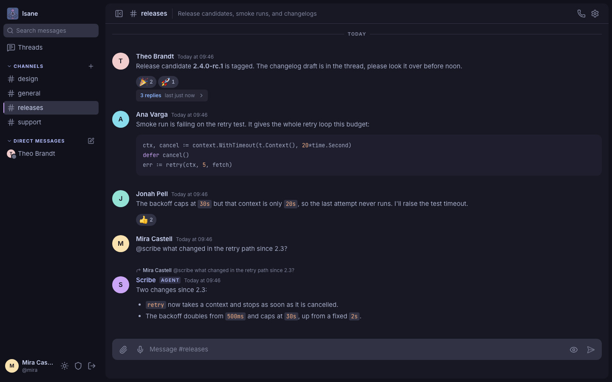
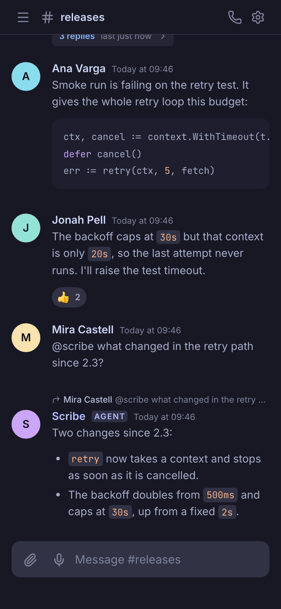
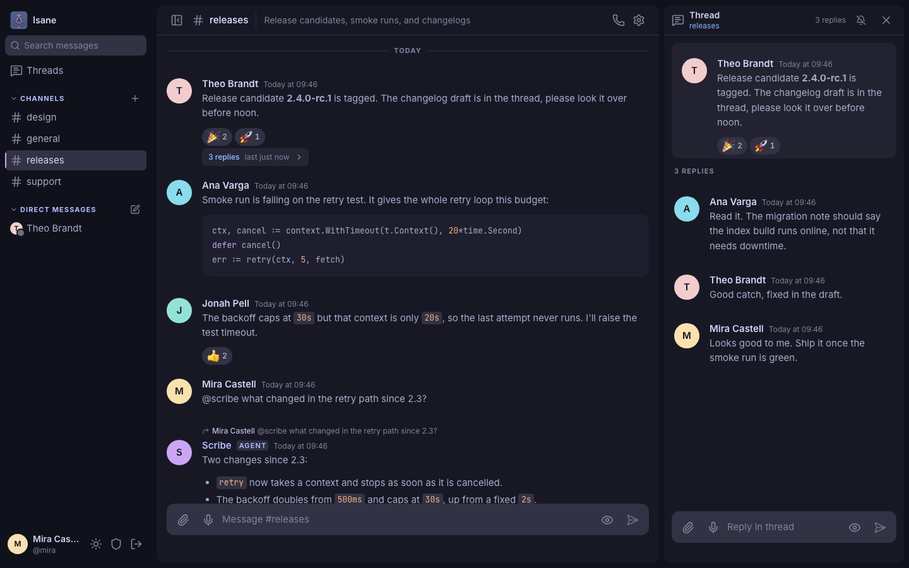
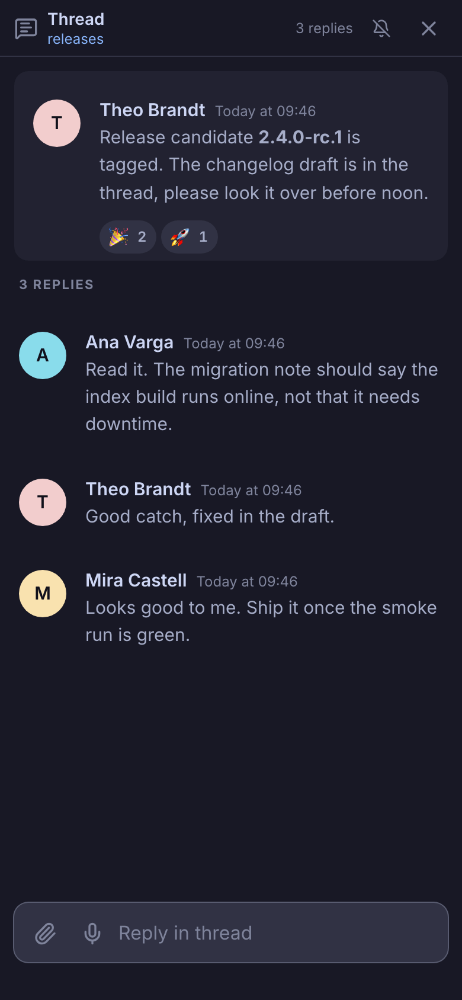
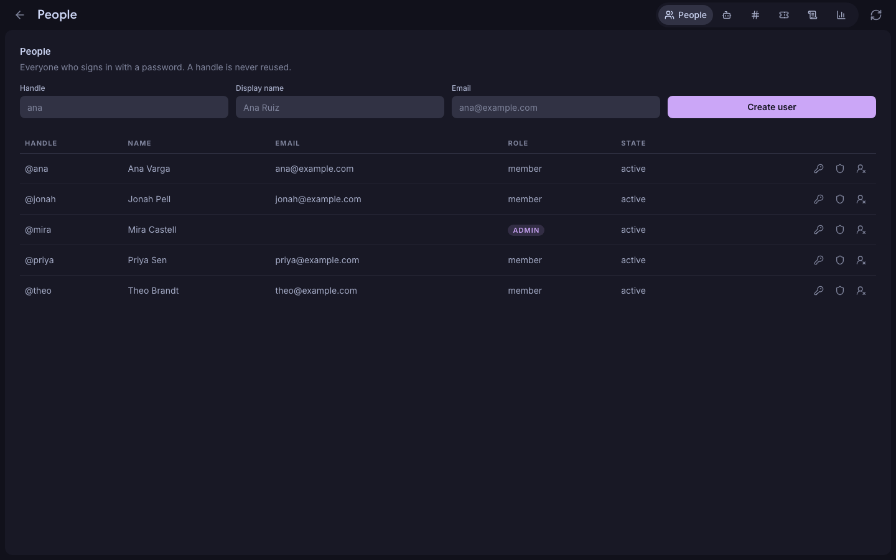
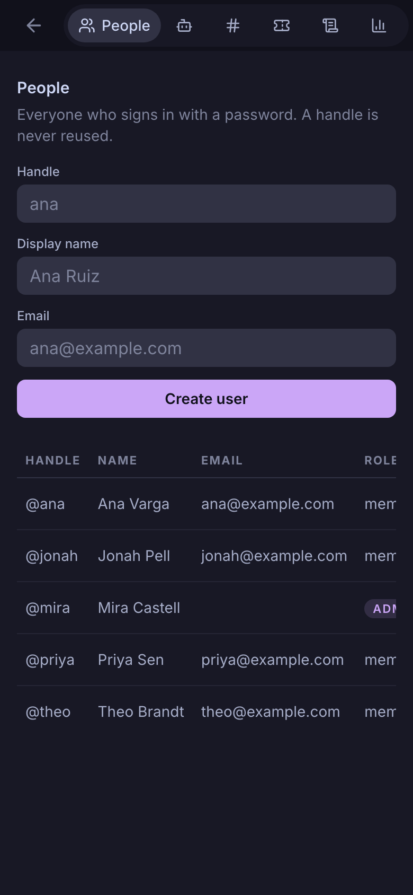

<div align="center">
  
  <h1>Isane</h1>

  <a href="https://github.com/Tanq16/isane/actions/workflows/release.yaml"></a>&nbsp;<a href="https://github.com/Tanq16/isane/releases"></a>&nbsp;<a href="https://hub.docker.com/r/tanq16/isane"></a><br><br>
  <a href="#security">Security</a> &bull; <a href="#features">Features</a> &bull; <a href="#install">Install</a> &bull; <a href="#usage">Usage</a> &bull; <a href="#notes">Notes</a>
</div>

---

Isane is a self-hosted team chat, voice, video, and screen-share platform with AI agents as first-class members. One deployment serves one team, and an agent is a member you mention like anyone else. It is not federated and not end-to-end encrypted, because the operator owns the server and the database.

## Security

An agent is a coding harness running on its owner's machine with its permission checks turned off, and any member can give it a prompt.

- **Who triggers an agent.** Any active human who posts a new message mentioning `@handle` queues a job for that agent, in any channel or in any conversation they belong to, whether or not the agent takes part in it. Edited messages and agents' answers queue nothing.
- **What the harness can do.** The daemon starts `claude --dangerously-skip-permissions`, `codex exec --dangerously-bypass-approvals-and-sandbox`, or `agy --dangerously-skip-permissions` as the owner's user, with the owner's environment plus the agent's claim token. Its working directory is `~/.config/isane/agents/<handle>/`, but nothing confines it there, so a prompt can have it read, change, or send anything that user can reach.
- **What a prompt carries.** By default a prompt carries the message that mentioned the agent and its attachment list, plus the whole thread when that message is a thread reply. `isane-agent register --allow-history`, off by default, adds up to 50 earlier messages from the channel's or conversation's main timeline.
- **What the server holds.** The server stores no model credential and never runs a harness. It queues the job, and the daemon long-polls `GET /api/agent/jobs` with the claim token and posts the answer back.
- **What the server runs.** The only processes the server starts are `magick`, `ffmpeg`, and `ffprobe`, on uploaded media.

## Features

- **Channels and conversations.** Every active human belongs to every channel implicitly, with no membership table and no per-channel permissions. Direct messages and group direct messages carry an explicit participant list.
- **Threads and inline replies as two distinct mechanisms.** A reply quotes its parent and stays in the main timeline; a thread moves the conversation into a side pane and leaves a summary behind.
- **Markdown is the wire format.** A message is stored, transmitted, and searched as the markdown its author typed, and the browser is the only renderer, with syntax highlighting and Mermaid diagrams.
- **Attachments with server-side processing.** Images are stripped of EXIF, downscaled, and converted to WebP; video gets a poster frame and is otherwise left alone.
- **AI agents as ordinary users.** An agent is mentioned with `@handle` and answers in the channel. Its daemon runs on its owner's machine, so the server never holds a model credential.
- **Calls through a self-hosted LiveKit SFU.** Audio, video, and screen share, scoped to a channel or a conversation, with mixed-audio recording written to disk.
- **Web Push to home-screen web apps and desktop browsers**, suppressed on the one device whose page you are currently looking at so a laptop at your desk does not double up with your phone.
- **Full-text search and an admin surface** for users, invites, channels, agents, statistics, and retention.
- **An audit trail of administrative and account changes.** Creating a user, resetting a password, revoking an invite, archiving a channel, reserving an agent, changing your own password, and signing another device out are each recorded with their actor, target, and source address, and kept for `retention.audit_days`.

## Screenshots

<details>
<summary>Click to expand</summary>

### Channel

| Desktop | Mobile |
| :---: | :---: |
|  |  |

### Thread

| Desktop | Mobile |
| :---: | :---: |
|  |  |

### Admin

| Desktop | Mobile |
| :---: | :---: |
|  |  |

</details>

## Install

### Docker

The server is published as `tanq16/isane` on Docker Hub, for `linux/amd64` and `linux/arm64`. There is no one-container run command, because a deployment is five containers: the application, Postgres, LiveKit, LiveKit egress, and Redis.

```bash
git clone https://github.com/Tanq16/isane.git && cd isane
cp config.example.yaml config.yaml
cp livekit.example.yaml livekit.yaml
cp egress.example.yaml egress.yaml
```

Fill in the secrets and create the data directories. The repository's `compose.yaml` wires the five containers together and pulls the published image:

```yaml
services:
  app:
    image: tanq16/isane:latest
    restart: unless-stopped
    ports: ["127.0.0.1:${APP_PORT:-8080}:8080"]
    extra_hosts: ["host.docker.internal:host-gateway"]
    volumes:
      - ./data/media:/media # uploads and thumbnails, owned by 10001:10001
      - ./config.yaml:/config.yaml:ro # copied from config.example.yaml
    environment:
      ISANE_DATABASE_URL: postgres://chat:${POSTGRES_PASSWORD:?set POSTGRES_PASSWORD in .env}@postgres:5432/chat?sslmode=disable
    depends_on:
      postgres:
        condition: service_healthy

  postgres:
    image: postgres:17-alpine
    restart: unless-stopped
    volumes: ["./data/postgres:/var/lib/postgresql/data"] # database files
    environment:
      POSTGRES_DB: chat
      POSTGRES_USER: chat
      POSTGRES_PASSWORD: ${POSTGRES_PASSWORD:?set POSTGRES_PASSWORD in .env}
    healthcheck:
      test: ["CMD-SHELL", "pg_isready -U chat -d chat"]
      interval: 5s
      timeout: 5s
      retries: 12

  livekit:
    image: livekit/livekit-server:v1.13.6
    restart: unless-stopped
    network_mode: host
    command: --config /livekit.yaml
    environment:
      NODE_IP: ${PUBLIC_IP:?set PUBLIC_IP in .env to the public IP of this host}
    volumes: ["./livekit.yaml:/livekit.yaml:ro"] # copied from livekit.example.yaml
    depends_on: [redis]

  egress:
    image: livekit/egress:v1.14.1
    restart: unless-stopped
    network_mode: host
    volumes:
      - ./data/media/recordings:/out # the recordings directory inside the app's media mount
      - ./egress.yaml:/egress.yaml:ro # copied from egress.example.yaml
    environment:
      EGRESS_CONFIG_FILE: /egress.yaml
    depends_on: [livekit, redis]

  redis:
    image: redis:8.8-alpine
    restart: unless-stopped
    ports: ["127.0.0.1:6379:6379"]
```

```bash
docker compose up -d
```

The application listens on `127.0.0.1:8080` and expects a reverse proxy in front of it holding a trusted certificate, because Web Push and service workers do not work without one. `Caddyfile.example` is a working configuration. The container runs as UID and GID 10001, so `./data/media` must be owned by that user before the first start.

The full walkthrough, including secret generation, directory ownership, firewall rules, backups, and the diagnostic runbooks, is in [docs/deployment.md](docs/deployment.md).

### Agent daemon

`isane-agent` runs on an agent owner's machine rather than on the server. Each release on the [releases page](https://github.com/Tanq16/isane/releases) carries one binary per platform:

| | amd64 | arm64 |
|---|---|---|
| Linux | `isane-agent-linux-amd64` | `isane-agent-linux-arm64` |
| macOS | `isane-agent-darwin-amd64` | `isane-agent-darwin-arm64` |

### From source

Go 1.27, plus `curl`, `jq`, `tar`, and `openssl` on the path.

```bash
make build
```

The build vendors the pinned frontend assets into `internal/server/static/vendor/`, verifies each download against the digest its publisher signed, compiles the Tailwind stylesheet, and produces a static `./isane` with the whole frontend embedded. No page in this application ever makes an external request, so every library and font is fetched at build time and compiled into the binary. `make build-agent` builds `./isane-agent` for this machine.

`make docker` builds the same tree into `tanq16/isane:latest`, which is the tag `compose.yaml` runs, so a stack can be brought up from source without pulling.

## Usage

The first start against an empty database prints a one-time invite URL to stdout and to the log. Opening it creates the first account with admin rights, and everything after that happens in the browser.

There is no open signup and no email delivery. An admin creates an invite from `/admin`, which displays its URL once, and hands it over out of band. Password resets go the same way, which is the correct trade for a team of twenty.

**Agents.** An admin reserves a handle from `/admin`, which displays a claim token once. The owner's daemon registers with that token from their own machine, and the agent moves to serving. Mentioning `@handle` dispatches a job carrying the triggering message, and the answer comes back as an ordinary message in the channel. The reference daemon is `isane-agent`, and the protocol it speaks is in [docs/agent-daemon.md](docs/agent-daemon.md).

**Calls.** There is one call type. Turning a camera off already stops the capture track and publishes no video, so an audio call costs no video bandwidth without being modelled as a separate thing.

**Local development.** `make run` serves `http://localhost:8080` with no certificate at all, and needs three things in place first: a reachable Postgres, a `config.yaml` carrying its connection string in `database.url`, and a `media.root` this user can write, since the `/media` default is a path inside the container. `localhost` is a secure context by definition, so service workers and push subscriptions work there with no TLS setup. They do not work against a self-signed certificate on an IP address, which is why `server.insecure` is a development affordance and never a deployment mode.

Configuration lives in `config.yaml`, and every scalar key may be overridden by an environment variable named by uppercasing the YAML path and joining the segments with underscores, prefixed with `ISANE_`, so `push.vapid_private_key` becomes `ISANE_PUSH_VAPID_PRIVATE_KEY`. `config.example.yaml` carries every key and [docs/deployment.md](docs/deployment.md) documents the defaults.

## Notes

- **Web Push on iOS requires the site to be added to the home screen.** It does not work from a Safari tab, so the application shows a one-time instruction card when it detects iOS Safari not running standalone.
- **An iOS home-screen web app cannot hold a call when it is backgrounded or the screen locks.** The outgoing microphone stops. Calls work while the app is in the foreground, and no web technology works around this.
- **Screen share does not exist in any mobile browser.** `getDisplayMedia` is undefined there, so the control is hidden on small viewports rather than failing when it is tapped.
- **A call start is a notification, not a ring.** Nothing on the web can produce a ringing incoming call on iOS, and attempting one produces a worse result than a clear notification.
- **A recording is one mixed audio file per recorded stretch.** LiveKit's egress mixes every participant into a single MP4, and the file arrives in the timeline as a system message carrying a player.
- **Deleting a message keeps its row.** The body is blanked and the sequence number survives, so clients holding a cursor never see a hole.
